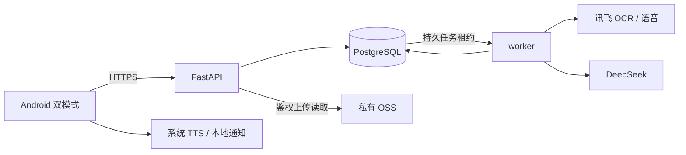

# Wellora（知安）架构与接口

2026-10-30（Asia/Shanghai）确认的开发约定，尚未实现。需求编号见[需求](需求.md)，页面与状态见[界面设计](界面设计.md)。Android 模板已存在；以下后端目录、数据表、路由和运行配置是计划，不是已部署服务。

## 1. 技术栈与职责

| 层 | 方案 | 职责／边界 |
| --- | --- | --- |
| Android | Kotlin、Jetpack Compose、ViewModel、Repository、协程／Flow、Navigation Compose | ViewModel 暴露状态；Repository 调 API 和本地保护存储；双模式共享业务状态 |
| 本地 | DataStore 保存非敏感偏好；Keystore 支持的加密文件保存草稿、会话凭证、缓存和提醒计划 | 不保存完整云端数据库；家庭资料不离线浏览；退出清凭证与敏感缓存 |
| API | Python 3.12、FastAPI、Pydantic 2、SQLAlchemy 2、Alembic、HTTPX | 单体模块处理会话、权限、版本、任务和供应商适配；不向客户端暴露数据库或密钥 |
| 数据库 | PostgreSQL 16 | 正式记录、授权、任务、用量、审计和删除台账；用迁移管理结构 |
| 工作进程 | 同代码镜像的独立 worker，PostgreSQL 持久队列 | OCR、AI、转写、PDF、备份恢复；初始并发 1，不引入 Redis、Celery、微服务 |
| 文件 | 阿里云 OSS，地域 `cn-shanghai`，Bucket `oss-pai-nj0fx54125p7y7intd-cn-shanghai` | 私有原图、附件、导出物和备份；后端逐次鉴权流式读取；凭据仅在服务端私有配置 |
| 部署 | 北京 Ubuntu Server 24.04，2 核 2GiB、40GiB、峰值 2Mbit/s、100GB 流量；公网 IP `114.116.233.113`；Docker 已安装；api.shushu520.top 暂不备案，HTTPS 待办 | 首轮测试 API、PostgreSQL、HTTPS 反代；数据库仅内网 |

Android 先在现有 `app` 单模块内分 `ui/feature`、`ui/navigation`、`ui/theme`、`data`、`model`、`core` 包；后端计划使用 `server/` 的 `api`、`services`、`models`、`providers`、`jobs`、`migrations`。Android 页面只使用原生 Jetpack Compose + Material 3，Stitch 的 HTML/CSS/JS/screen.png 仅作视觉参考；禁止 WebView、iframe、浏览器容器和 HTML 页面加载。部署初始一个 API 和一个 worker；数据库只进内部网络。首轮为虚构数据测试版，后端域名为 api.shushu520.top；用户暂不备案。WireGuard 手机 peer 未握手，P018 改用用户确认的 Cloudflare Quick Tunnel 进行临时 HTTPS 联调：API 与数据库仍不映射公网端口、不启动 Caddy，临时 `trycloudflare.com` 地址由隧道进程提供并转发至内部 API，经 Cloudflare 网络传输，仅使用虚构资料；测试后关闭隧道。debug 按 HTTPS 基址请求；公网正式服务仍须完成适用的备案／接入核验及 TLS。不得将 API 的明文 HTTP 直接暴露公网。

### Android 原生 UI 架构与页面映射（P004）

- `MainActivity.kt`：应用入口、状态保持和代表页路由；使用 `Scaffold` 承载原生底部导航。
- `ui/navigation/WelloraNavigation.kt`：`home`、`records`、`medications`、`account` 四项一级导航，图标为 Compose Material Icons，选中态由 Material 3 `NavigationBar` 渲染。
- `ui/feature/home/HomeScreen.kt`：S01 标准模式首页的可组合组件（标题区、模式切换、咨询入口、四功能卡、健康小结、报告／待办列表和无障碍语义）。本轮仅该页完成；其他一级导航和二级入口显示明确的原生 Compose 占位状态，不冒充已实现业务。
- `ui/theme/`：集中维护 #F6F8F5、#176B57、#E8F3EE、#172C28 等有效主题值和字体层级；关闭动态颜色，确保原型对照稳定。

页面映射沿用[界面设计](界面设计.md)的语义标识：`home→HomeScreen`（本轮代表页）；`records→records/RecordsScreen.kt`、`consultation→consultation/ConsultationScreen.kt`、`report-review/detail/compare→reports/*`、`medications→medications/MedicationsScreen.kt`、`department-guide→consultation/DepartmentGuideScreen.kt`、`display-mode/account→account/*` 为后续实现路径。`S01` 的报告、日期和健康小结是原型示例数据，页面明确标记“示例”，不得视作真实健康记录。

本轮新增依赖仅为官方 `androidx.compose.material:material-icons-extended`（Compose BOM 2026.02.01 管理版本），用于离线打包的原生矢量图标；仓库为 AndroidX，Apache-2.0，随 Compose 维护，兼容当前 Compose BOM。未引入第三方组件库。

## 2. 数据流

报告流程为上传→任务→OCR 草稿→人工确认→已确认版本→解读／对比。OCR、转写和模型回答不能改变权限或绕过确认；报告修改会使旧解读、摘要和对比过期。任务执行前及落库前重验授权、对象未删除、输入版本未改变；晚到结果标 `stale`，失权或删除则取消和清理。

## 3. 核心对象

ID 使用不透明 UUID；时间存 UTC、接口 RFC3339；医学数值保留原文、十进制值和单位。可变对象含 `version`；权限以服务端 `profile_id` 归属为准。

| 对象 | 最小字段 | 约束 |
| --- | --- | --- |
| account / session | id、username、password_hash、status；token_hash、expires_at、revoked_at | 用户名唯一；Argon2id；令牌只存哈希；无邮箱验证和找回 |
| profile / health_record | owner_account_id、display_name、birth_date；kind、value_state、content、source_type、source_file_id、actor_id、confirmed_at、version | unknown、none、recorded 分开；医生结论和 AI 解释分开 |
| family_invitation / grant | inviter_id、invitee_id、profile_id、scopes、expires_at、status、version | view、edit、remind、export；edit 依赖 view，export 独立 |
| file_asset | profile_id、kind、object_key、sha256、mime、size、actor_id、status | 私有 OSS；跨账号不泄露去重信息 |
| report / report_revision | profile_id、file_ids、status、current_revision；patient、exam_date、institution、actor_id、confirmed_at、version | OCR 与人工修订分开；确认修订不可原位覆盖 |
| observation | report_revision_id、name_raw、canonical_code、value_raw、value_decimal、unit_raw、reference_raw、specimen、method、conditions、field_status | 低置信／缺失／确认分开；条件不足不假定可比 |
| analysis / comparison | profile_id、input_revision_ids、provider、model_id、prompt_version、sources、generated_at、status、result | queued、running、succeeded、failed、stale；不可比含 reason |
| consultation / message | profile_id、role、content、source_type、referenced_revision_ids、created_at、status | 区分用户、医生、AI；历史按权限和相关性使用 |
| medication_plan / dose_event | profile_id、drug_name、strength、dose、dose_unit、schedule、timezone、date_range、prescription_source、version；occurrence_id、state、actor_id | unconfirmed、taken、skipped；medical_check=unavailable |
| followup / reminder / notification | profile_id、doctor_conclusion、source、next_visit；schedule_version、due_at、recipient、delivery_state | 阅读不等于服药；本地触发、站内生成、送达、确认分开 |
| export / backup / restore | profile_id、variant、selected_ids、input_versions、file_id、status、expires_at；manifest_version、encryption_meta、conflicts | 恢复先验证、预览和确认，不静默覆盖 |
| job / usage / audit | kind、actor_id、profile_id、input_refs、idempotency_key、attempt、lease_until、status；provider、units、reserved_cost、actual_cost | 日志不存健康正文、密码、令牌；费用和状态可追溯 |
| deletion_tombstone | object_type、object_id、deleted_at、cleanup_status | 无健康正文；阻止读写及备份复活 |

## 4. API 公共约定

### P017 实现进度（2026-11-10）

`server/app.py` 已落地 `/health`、`/auth/register`、`/auth/login`、`/auth/logout`、`GET/POST /profiles`、`GET/PATCH /profiles/{profile_id}` 测试骨架。注册仅返回 account_id；登录签发 7 天会话；密码 Argon2id，令牌只存 SHA-256；本人仅有一份档案，未知生日可空。档案列表与逐 ID 操作均校验归属，更新采用版本条件更新。注册在 PostgreSQL 下以事务 advisory lock 序列化 20 活跃账号上限；登录按用户名失败 5 次、IP 失败 30 次限制在 15 分钟窗口。IP 只取受信代理提供的连接地址，部署时必须限制代理来源，不能信任任意公网 Forwarded 头。

SQLAlchemy 模型由 Alembic 初始迁移创建；依赖版本见 `server/uv.lock`。本机 SQLite API 测试及目标服务器 PostgreSQL 16.15 的账号／档案验证已完成，公网 TLS 和真机业务验收仍待补。P021 已实现本人健康记录 CRUD 与创建幂等；P022 已实现本机鉴权文件上传／下载和可注入 OSS 适配器，仅用假存储验证，未连接真实 Bucket。其余首版约定仍以各功能记录中的状态为准。

本轮第三方依赖使用 Python 生态包而非复制项目：FastAPI、SQLAlchemy、Alembic、Pydantic、pwdlib、HTTPX、pytest 为 MIT；Uvicorn 为 BSD-3-Clause；psycopg 为 LGPL-3.0、其 binary 分发附带依赖许可证须部署前核对。准确安装版本与哈希记录在 uv.lock；依赖不计为自主业务实现。

部署编排 `server/docker-compose.yml` 只发布 Caddy 的 80／443；API 不发布宿主机端口，PostgreSQL 仅在私有数据网。API 只信任固定 Caddy 地址 `172.29.240.2` 转发的客户端 IP；需要确认该 Docker 子网不与宿主机路由冲突。启动前必须填写真实 `PUBLIC_HOST`，通过云厂商核实北京服务器域名的 ICP 备案／接入要求并开放 80／443。Caddy 自动签发／续期证书，数据库卷和 Caddy 证书目录持久化。用户已选 api.shushu520.top 并暂不备案；容器构建及私有服务启动已实测，172.29.240.0/24 与宿主路由无重叠，TLS 未验证，本阶段不启动公网代理。

前缀 `/api/v1`。JSON UTF-8；集合 `{items,next_cursor}`；后台任务返回 202 和 `{task_id,status}`。除注册、登录、无健康信息的健康检查外均需 Bearer Token。

- 会话 7 天，可退出、改密、删除撤销；敏感操作密码复验获得 5 分钟、绑定当前会话的 `reauth_token`。不做自动找回，试用前明确告知忘记密码无法绕过认证读取健康资料。
- 用户名 3–32 位 ASCII 字母／数字／下划线，密码 12–128 字符；注册上限 20 个活跃试用账号。
- 权限由服务端逐次判断。无可见权返回 404，已可见但无操作权返回 403。
- 创建、消息、打卡、付费任务、恢复用 `Idempotency-Key`；24 小时同键同输入返回原结果，异输入 409 `IDEMPOTENCY_CONFLICT`。
- 更新和删除需 `version` 或 `If-Match`；不一致返回 409 `VERSION_CONFLICT`。上传检查签名、页数、大小；Range 下载也鉴权，不重定向公开 OSS URL。
- 本轮 P022 文件 API 只收 JPEG/JPG、PNG、PDF，文件体最多 20 MiB。服务端从扩展名与文件签名识别格式，不信任客户端 Content-Type；不接受格式不符文件（422），超限（413）。对象键由服务端生成，不返回 Bucket 地址、OSS URL 或签名 URL；下载每次校验本人档案并经 API 流式返回。PDF 页数、恶意软件扫描、未引用文件期限清理、删除台账联动及 Range 下载尚未实现，启用真实健康资料前必须补齐。
- 列表默认 20、上限 100 条，使用不透明游标；检查日期用 `YYYY-MM-DD`，用药日程携带 IANA 时区。值字段以十进制字符串传输，保留原始比较符号与参考范围。

### 路由清单

| 方法／路径（省略 `/api/v1`） | 权限 | 请求／响应重点 | 需求 |
| --- | --- | --- | --- |
| GET `/` | 公开 | 200 `{"service":"Wellora API","status":"ok","health":"/api/v1/health"}`；不暴露版本、配置或健康数据 | R016 |
| GET `/health` | 公开 | 200 `{status:"ok"}` 或 503；不暴露数据库配置或健康数据 | R016 |
| POST `/auth/register`；POST `/auth/login`；POST `/auth/logout`；POST `/auth/reauth` | 公开／当前账号 | 注册 `{username,password}`；登录返回 token；复验返回短期 token；重名 409、错凭证 401 | R014 |
| GET/POST `/profiles`；GET/PATCH `/profiles/{id}`；GET/POST `/profiles/{id}/records`；PATCH `/records/{id}` | 本人／view／edit | 基础资料和来源记录；来源无权 422；版本冲突 409 | R003 |
| POST `/profiles/{id}/files`；GET `/files/{id}/content` | 本人／view | multipart 上传返回 file_id、sha256、status、duplicate；413／422／503；下载仅经 API 文件流返回 | R004、R015 |
| POST `/profiles/{id}/reports`；GET `/reports/{id}` | edit／view | 创建报告及原文件引用；患者不匹配 422、重复返回 duplicate_of | R004 |
| POST `/reports/{id}/ocr`；GET/PATCH `/reports/{id}/draft`；POST `/reports/{id}/confirm` | edit | 任务 202；草稿可改；确认返回 revision；关键项未确认 422 `REPORT_UNCONFIRMED` | R004 |
| POST `/reports/{id}/analyses`；GET `/analyses/{id}`；POST `/profiles/{id}/comparisons`；GET `/comparisons/{id}` | view | 仅已确认版本；202 任务；输入过期 409；比较结果含 points、comparable、reason、sources | R005、R011 |
| GET/POST `/profiles/{id}/consultations`；GET/POST `/consultations/{id}/messages` | view／操作者 | 文字消息及引用版本；失败保留原消息，不编回答；可继续历史 | R005、R013 |
| POST `/profiles/{id}/transcriptions` | 本人／edit | 音频任务返回转写，用户编辑后才正式写入；格式错误 422 | R004、R005 |
| POST `/profiles/{id}/department-guides`；GET `/department-guides/{id}` | view | 返回首选、备选、理由、补问、来源和 `risk_assessment_status`；不造预约 | R008 |
| GET `/capabilities`；GET `/emergency-config` | 登录／配置可匿名 | 医学风险和药品校验当前 `unavailable`；紧急配置不含健康数据 | R007 |
| GET/POST `/profiles/{id}/medications`；PATCH `/medications/{id}`；POST `/medications/{id}/confirm` | view／edit | 药品、剂量、频次、来源和版本；未匹配为 `medical_check=unavailable` | R006 |
| PUT `/medications/{id}/occurrences/{occurrence_id}`；POST `/medications/{id}/snoozes` | edit | `state=taken|skipped|unconfirmed`；重复幂等；旧计划版本冲突 | R006 |
| GET/POST `/profiles/{id}/followups`；PATCH `/followups/{id}` | view／edit | 复诊结论、附件、处方变更待确认、下一次提醒 | R012 |
| POST `/profiles/{id}/invitations`；GET `/family/invitations`；POST `/family/invitations/{id}/accept`、`/family/invitations/{id}/decline` | 本人／被邀请账号 | scopes 为 view、edit、remind、export；24 小时过期；双方确认 | R009 |
| GET `/profiles/{id}/grants`；GET/PATCH/DELETE `/profiles/{id}/grants/{grant_id}` | 仅本人改／撤销 | 撤销 204 后失效任务、通知和旧会话访问 | R009、R015 |
| GET `/notifications`；PATCH `/notifications/{id}` | 接收者 | `read_at` 不修改 dose_event；失权后不返回关联详情 | R006、R009 |
| GET `/knowledge`、`/knowledge/{id}` | 登录 | 仅已审核条目，含来源和更新时间；无内容为空列表 | R013 |
| POST `/profiles/{id}/exports`；GET `/exports/{id}` | 本人／export／复验 | 医生／通俗版本、范围、输入版本；202 后返回文件与来源 | R010 |
| POST `/profiles/{id}/backups`；POST `/profiles/{id}/restores/preview`；POST `/restores/{id}/confirm`；GET `/restores/{id}` | 仅本人／复验 | 加密备份、冲突预览、逐项确认；错误 422 `BACKUP_INVALID` | R010、R015 |
| GET `/tasks/{id}`；POST `/tasks/{id}/retry` | 原操作者仍有权 | 状态查询／重试；撤销 404，超预算 429，不重复业务结果 | R016 |
| POST `/tasks/{id}/secret` | 仅本人、复验 | `{passphrase,reauth_token}`；仅 awaiting_secret 任务接收，转交 worker 内存，不持久化；超时需重输 | R010、R015 |
| DELETE `/records/{id}`、`/reports/{id}`、`/account`；GET `/deletions/{id}` | 本人／复验 | 202 立即封锁；完成为 completed，失败 cleanup_failed | R015 |

示例：`POST /api/v1/reports/REPORT_ID/analyses` 携带 `Authorization` 和 `Idempotency-Key`，请求 `{"revision_id":"REVISION_ID"}`，响应 `{"task_id":"TASK_ID","status":"queued"}`。错误统一为 `{"error":{"code":"VERSION_CONFLICT","message":"资料已更新，请查看新版本后重试","request_id":"REQUEST_ID"}}`。常见 401/403/404、409、413/422、429、503 分别表示会话／权限、版本／幂等、输入、限流预算、供应商不可用；客户端保留输入、禁止展示占位医疗结果。

### 业务输入与输出示例

以下 ID、姓名和数值是接口槽位，不是用户事实；所有写入只接收允许字段，来源／操作者／时间由后端补充，不由客户端伪造。创建资源 201，普通读取／更新 200，撤销／退出 204，耗时处理 202。

| 接口组 | 最小请求 | 结果／失败约定 |
| --- | --- | --- |
| 注册／登录／改密 | `{username,password}`；`POST /auth/change-password` 需 `{current_password,new_password}` | 注册 `{account_id}`；登录 `{access_token,expires_at,account_id}`；改密撤销全部会话；错凭证统一 INVALID_CREDENTIALS，避免暴露账号存在性 |
| 档案与记录 | `{display_name,birth_date}`；记录 `{kind,content,source_type,source_file_id}`；修改加 `version` | 首版一账号一本人档案；返回 profile／record 及 version；家人以账号邀请取得权限，不匿名代建绕过授权 |
| 文件和报告 | multipart `{file,kind}`；报告 `{file_ids}`；OCR `{version}` | 文件 `{file_id,sha256,status}`；报告 `{report_id,status,version,duplicate_of}`；哈希相同只在同档案提示重复 |
| 校对与确认 | 草稿 `{version,fields}`；确认 `{version,confirmed_fields,missing_fields}` | 返回 revision_id、status、version；患者与关键值未确认拒绝分析；缺失单位可存草稿，不能猜填或默认可比 |
| 对比与解读 | `{revision_ids}`（对比至少两份）；解读 `{revision_id}` | GET 结果带 input_revision_ids、sources、generated_at、provider、model_id、prompt_version、status；每点原值、日期、单位、参考范围、可比性原因 |
| 咨询与科室 | 消息 `{text,revision_ids}`；科室 `{consultation_id,revision_ids,symptom_text}` | 消息先落库再排任务；科室 `{primary,alternatives,reasons,questions,sources,risk_assessment_status}`；状态 unavailable 不等于普通风险 |
| 用药计划与打卡 | `{drug_name,strength,dose,dose_unit,schedule,timezone,date_range,prescription_source}`；打卡 `{version,state}`；稍后 `{occurrence_id,remind_at}` | 确认前 draft，确认后 active；occurrence_id 由后端按计划版本生成；旧计划 occurrence 409，撤销打卡保留审计 |
| 复诊 | `{visit_date,department,doctor_conclusion,source_file_ids,next_visit}` | 返回 followup_id、version；处方变化不覆盖现计划，进入药品核对流程 |
| 家属邀请／授权 | `{invitee_username,scopes}`；接受 `{}`；改权 `{version,scopes,reauth_token}` | pending→active／declined／expired／revoked；仅邀请指定账号可接受；export 默认 false，edit 必须含 view；需查看权限才能下载与导出 |
| 导出／备份 | `{variant,selected_ids,input_versions,reauth_token}`；备份另需一次性 passphrase | 任务结果 `{file_id,expires_at,sources}`；variant 为 doctor／plain；导出操作必须有 export 权，输入资料过期 409 |
| 恢复 | 预览 multipart `{file,passphrase,reauth_token}`；确认 `{version,resolutions,reauth_token}` | 返回重复／冲突清单；resolutions 为保留当前或作为新修订导入；恢复只能本人原档案，已删对象拒绝复活 |
| 删除 | `{version,reauth_token}` | `{deletion_id,status,status_token}`；status_token 仅查询删除进度，不能读取健康资料，7 天过期；完成清理后 completed，不能将仅封锁写成删除完成 |

未列出的字段和专业阈值不得擅自添加为必填业务；实现 Pydantic 模型时以本表与第 3 节为基线细化 OpenAPI，并同步文档，不能反向改变需求。

## 5. 任务、外部服务与预算

任务 queued→running→succeeded／failed／stale／cancelled；worker 用 `FOR UPDATE SKIP LOCKED` 取任务，租约 60 秒、每 15 秒续期，超期回收，结果唯一约束防重复落库。预算预留与任务创建在同一事务，发送供应商请求前写调用记录。OCR、模型和语音均通过独立 provider 适配器，记录产品、模型和请求 ID，只发送必要资料。

租约回收若发现供应商调用已发送但结果不明，转入 failed／PROVIDER_RESULT_UNKNOWN 并核查，不重新发送付费请求；“可恢复任务”不等于外部调用可以无条件重放。恢复和导出前也要重验输入版本、授权与删除台账。

DeepSeek 用于通俗解释、咨询、科室参考；讯飞用于 OCR 和普通话转写；Android 系统 TTS 负责播报。具体模型、产品、格式、额度、价格和留存条款未核实，不能据协议兼容声称已联调。连接超时初值 10 秒，AI／OCR 读超时 120 秒，语音 90 秒；仅请求未发送或明确未受理时按 2／8 秒退避最多重试两次。已受理但结果未知先查供应商状态，无查询能力则 PROVIDER_RESULT_UNKNOWN，人工重试告知可能再次计费，不静默重发。

月度外部服务目标 100 元（Asia/Shanghai 月界，含模型、OCR、语音、OSS／流量，服务器另计）。接入前按最大输出／页数／时长预留费用，数据库锁定月余额；超预算返回 429 `BUDGET_EXCEEDED`，暂停新付费任务，不编造结果。初始预留 20 元给 OSS／流量，AI／OCR／语音池最多 80 元，待单价和账单核实再调整；单价未配置或实际费用未知时关闭新的付费调用，未核清的请求预留不释放。供应商账单可能延迟，不承诺本地估算是硬账单上限。初始每分钟账号 5 次、全局付费并发 1，实测后调整；登录连续失败 5 次冷却 15 分钟，并按 IP 限流。

## 6. 提醒、备份与删除

手机本地系统闹钟调度已确认计划，WorkManager 作校准；权限缺失或厂商限制需展示，不能承诺必达。计划变更、重启、时区变化重建调度并取消旧版本；正式服药状态必须联网确认，本地操作仅待发送。家属使用站内消息，前台及后台尽力同步，首版不接厂商推送，不承诺实时后台提醒；阅读不等于服药确认。锁屏默认仅显示“您有一条健康提醒”。

PDF 从同一份已确认事实快照派生医生版和通俗版，包含资料截止时间、来源和 AI 标识；导出物 24 小时后失效。用户备份采用版本清单和标准密码库实现的 AES-256-GCM、Argon2id 派生，随机盐与 nonce；口令不落库、不进任务载荷。需口令的任务进入 awaiting_secret，API 接收一次性口令并通过本机受限 Unix socket 交给单 worker（不走数据库队列），只留内存，worker 重启或未及时接收须重输；恢复需本人复验、预览、冲突选择。解密验证完整性、所属人、清单版本和文件哈希，限制解压大小并拒绝路径穿越，密钥／会话不放备份。实现时先验证该口令传递小流程，再纳入恢复，不引入额外常驻消息服务。

系统数据库和文件每日加密备份，最长保留 30 天；独立目的地和费用待确认，必须做恢复演练。删除同事务写 `deletion_tombstone`、撤销相关授权、取消任务并立即封锁；删账号还撤销全部会话。清理数据库、OSS 原图／历史版本、导出物、缓存和载荷后才 completed，失败为 cleanup_failed 并重试。删除台账独立加密保存，不含病情正文，至少覆盖全部相关备份保留期；系统恢复先应用最新台账，台账丢失或旧于备份则禁止开放服务，旧会话不恢复。用户备份也不能复活已删对象；第三方留存和删除限制须真实试用前核实。

## 7. 配置和接入门槛

计划环境项：`DATABASE_URL`、`PUBLIC_BASE_URL`、`OSS_REGION`、`OSS_ENDPOINT`、`OSS_BUCKET`、`OSS_ACCESS_KEY_ID`、`OSS_ACCESS_KEY_SECRET`、`DEEPSEEK_API_KEY`、`DEEPSEEK_MODEL`、`XFYUN_APP_ID`、`XFYUN_API_KEY`、`XFYUN_API_SECRET`、`XFYUN_OCR_PRODUCT`、`XFYUN_ASR_PRODUCT`、`MONTHLY_BUDGET_CNY`、`BACKUP_DESTINATION`。真实 `.env` 不入 Git；本轮不创建虚构可运行配置。

| 项目 | 当前事实 | 接入前门槛 |
| --- | --- | --- |
| OSS | 地域 `cn-shanghai`，Bucket `oss-pai-nj0fx54125p7y7intd-cn-shanghai`；本机假存储验证，不表示真实云端联调 | 核实 Bucket 私有访问、最小权限 RAM 凭据、安全传输／静态加密、版本控制与删除策略、生命周期、跨地域数据流和告知后，才配置服务器联调 |
| DeepSeek／讯飞 | 服务商已选，具体产品、模型、账号额度、单价未知 | 官方文档核实接口、格式、留存、账单；脱敏样本联调 |
| TTS／提醒 | Android 系统中文播报，目标设备未定 | 验证语音包、录音格式、通知／闹钟权限和重启恢复 |
| 域名／HTTPS | 暂无 | 开通并验证 TLS 后才能公网真实资料试用；Caddy 仅为计划 |
| 医学／科普 | 暂无药品库、风险规则和专业审核 | 能力不可用；科普须来源、更新时间和发布审核 |
| 灾备／期限 | 外部服务月目标 100 元，期限未定 | 独立灾备位置、价格实核、恢复演练和阶段排期 |

### 第三方来源和自主实现边界

P022 使用阿里云官方 Python SDK `oss2==2.19.1`（MIT）及 `python-multipart==0.0.33`；版本见 `server/uv.lock`。SDK 只作私有对象存储客户端，不复制开源业务代码。第三方服务条款、区域端点／加密策略和 RAM 权限仍需真实联调前核验。

| 来源 | 使用范围／许可证登记状态 |
| --- | --- |
| [Android Jetpack](https://developer.android.com/jetpack)、[Kotlin](https://kotlinlang.org/) | 客户端框架与模板；沿用现有版本目录，逐依赖核许可证后登记 |
| [FastAPI](https://fastapi.tiangolo.com/)、[SQLAlchemy](https://www.sqlalchemy.org/)、[Alembic](https://alembic.sqlalchemy.org/)、[Pydantic](https://docs.pydantic.dev/)、[HTTPX](https://www.python-httpx.org/) | 后端框架、数据库、验证、HTTP；锁定版本时核许可证 |
| [PostgreSQL](https://www.postgresql.org/)、[Docker](https://www.docker.com/)、[Caddy](https://caddyserver.com/) | 数据库与部署基础；镜像及运行版本许可证待核，不将基础软件算自主开发 |
| [DeepSeek](https://api-docs.deepseek.com/)、[讯飞开放平台](https://www.xfyun.cn/)、[阿里云 OSS](https://www.aliyun.com/product/oss) | 商业 API／存储，按实际产品条款与费用接入，不宣称自研模型／OCR／语音 |
| 用户提供的 Stitch 素材 | 原始字节归档；字体、图标、外链素材授权待核实，HTML 不作为 Android 实现直接复制 |

计划自主实现的是业务状态与权限、报告校对和版本、可比性处理、任务与费用控制、双模式交互、摘要与恢复流程；P017 已完成账号／本人档案测试骨架；其他模块仍待实现。

### P017 内部部署补充（2026-11-10）

服务器 SSH 公钥登录已验证；Ubuntu 24.04.4，部署目录固定 `/opt/wellora`。用户选定 `api.shushu520.top`、暂不备案，先内部验证。只启动 Compose 的 `db`、`api`，不启动 `proxy`，API 与数据库均不映射宿主机端口；在 API 容器内请求 `127.0.0.1:8000`。通过容器重启及持久 PostgreSQL 卷验证资料保留；集成测试使用随机虚构账号，末尾清理测试记录，真实凭据留在服务器不提交。TLS／域名解析和手机联调保持待办。

### P018 Android 接口接入与临时 HTTPS 测试

账号与本人档案通过 Android `data` 层调用现有 `/api/v1/auth/{register,login,logout}` 和 `/api/v1/profiles` 契约。API 基址由 `welloraApiBaseUrl` Gradle 属性或未跟踪的 `local.properties` 配置；模拟器默认本机映射，手机联调使用临时 HTTPS 隧道地址。仅 debug 基址可覆盖；release 固定正式 HTTPS 域名且不允许明文。会话令牌用 Android Keystore AES-GCM 密钥加密后存于私有 SharedPreferences，禁用 Android 云备份；不保存密码。登录恢复后拉取本人档案，创建／更新仍使用服务端版本字段；退出时撤销服务端会话并清除本地令牌。网络错误不回退或伪装成示例档案。

WireGuard 是已配置但未完成手机握手的备选路径：服务器 `10.66.0.1/24:51820/UDP`，手机 `10.66.0.2/32`；Docker API VPN 发布配置仅绑定宿主 `10.66.0.1:8000`。P018 当前改用 Cloudflare Quick Tunnel 容器加入 API 所在 Docker 网络，访问 `http://api:8000`；不使用 `--network host`、不映射宿主机公网端口、不改变 API／数据库绑定。Quick Tunnel 临时地址在启动日志中动态分配，不能视为稳定域名；外部测试经 Cloudflare 转发，只使用虚构资料，完成后停止隧道容器。隧道属于公开 URL，任何获得地址者均可尝试访问测试 API，不能存放真实健康信息或凭据。

### P018 临时隧道实测边界（2026-11-10）

Quick Tunnel 2026.10.7 已通过 HTTPS 健康接口与 Android 模拟器 11 项测试；手机尚待验收。cloudflared 通过 Daocloud 镜像获取，摘要 `sha256:4955524aeaa379e154023d5a027c250f7b35041a2e7e950cf13f144bc9b9c5ba`，来源 https://github.com/cloudflare/cloudflared （许可证内容待核）。容器无发布端口、restart=no；停止命令 `docker stop wellora-quick-tunnel`。API 不额外信任公网转发头，隧道流量统一按内部连接地址限流，尚未实现逐最终客户端 IP 限流；该状态仅适合当前少量虚构数据测试。公网 URL 并非访问控制；测试结束关闭。临时通道不改变正式部署及备案要求。

### P020 冒烟重启等待与测试范围（2026-11-13）

`server/tests/deployment_smoke.py verify` 在访问持久化状态前，最多轮询 `/api/v1/health` 30 次、间隔 1 秒；只有返回 200 `{"status":"ok"}` 才继续，超时则失败。该等待只处理容器重启后的服务就绪时序，不改变 API 契约或健康语义。P020 完成账号／本人基础档案测试后端的本机 API、PostgreSQL 重启与 Android 模拟器 HTTPS 自动验证；它不实现 R004 及后续业务功能，也不替代真机、备案或正式 TLS 验收。详细命令与结果见 `evidence/transactions/P017-backend/AUTO_TEST_20261113.json`。
## P021 健康记录 API（2026-11-14）

本机实现 `GET/POST /api/v1/profiles/{profile_id}/records` 与 `PATCH /api/v1/records/{record_id}`，新增 Alembic `0002`。记录值用 `value_state=unknown|none|recorded` 区分未知、无此项和已有内容；`recorded` 必须有内容，其余状态内容为空。来源仅接受 `user_statement`、`doctor_conclusion`、`ai_explanation`。`actor_id` 始终由当前会话决定；`confirmed_at` 表示账号操作者提交／确认，不证明医生身份或临床真实性；AI 解释保持未确认。`source_file_id` 暂不允许客户端提交，响应为 null，待文件模块接入。

列表使用默认 20、最大 100 的时间／ID 游标；仅本人可读写，跨账号返回 404。创建要求 `Idempotency-Key`，24 小时内相同键与输入返回原响应，异输入 409；过期快照在健康记录 API 后续请求时清理。修订采用乐观版本，过期版本返回 409 `VERSION_CONFLICT`。

仅 SQLite 本机往返迁移和 API 测试已验证；远端 PostgreSQL 尚未迁移。当前未连接 OSS、讯飞 OCR／ASR 或 DeepSeek；地域、产品／型号、价格／配额仍待核实，本轮不得称为报告闭环或生产部署。验证证据：`evidence/transactions/P021-health-records/VERIFICATION.txt`。

### P021 目标 PostgreSQL 部署续记（2026-11-14）

SSH 使用专用密钥成功连接 `/opt/wellora/server`；迁移前数据库为 `0001`，accounts/profiles/sessions 均为 0，另保留 1 条既有共享 IP 限流行。先备份 API 源码、迁移目录及旧镜像，再用新镜像执行 `0002` 并重建私有 API。部署后 Alembic `0002 (head)`、健康 200；16 项远端 PostgreSQL 冒烟通过，清理后 accounts/profiles/sessions/health_records/idempotency_keys 均为 0。login_throttles 保留 7 个哈希键（其中 1 个部署前存在、6 个零失败键创建于本轮两次登录冒烟的时间窗口）；由于共享 IP 键无法安全归属，未删除。API Docker 端口仅绑定 WireGuard 私网 `10.66.0.1:8000`，DB `5432/tcp` 未发布到宿主机。Quick Tunnel 容器仍运行、restart=no；WireGuard latest handshake 为 0；不得以此视作手机业务验收或公网生产部署。回滚镜像和备份路径及确切 SHA 见 P021 交易验证。

## P023 香港主服务器与子域部署（2026-11-14）

用户指定香港 `server1` 为 Wellora 项目主服务器；DNS `api.shushu520.top → 38.76.195.17` 已由公网证书申请与 API 请求验证。主机为 Ubuntu 22.04 LTS x86_64，Docker 29.1.3/Compose 2.40.3；原主站和旧 API/DB 均保持。Wellora 使用 Compose 项目 `wellora-hk` 和独立 PostgreSQL volume，API 只发布宿主机 `127.0.0.1:8010`，Nginx 专属子域 vhost 使用 Let's Encrypt 证书（2027-02-12 到期并受 certbot timer 自动续期）；续期后由 `/etc/letsencrypt/renewal-hooks/deploy/20-reload-nginx` reload Nginx，数据库无 host port。部署前移除根目录 `migrations` 与 `versions` 的不可读权限，Dockerfile 增加 `chmod -R a+rX /app/migrations`，容器以 UID 10001 运行并成功执行 Alembic `0003`。虚构账号／本人档案、权限隔离、并发上限、退出、重启持久化及清理都已验证。OSS 凭据已通过交互式 PowerShell 安装器写入服务器私有 `.env`（root:root 0600；值不记录到代码或日志）；真实 OSS 鉴权上传／下载使用虚构 PNG 验证成功并清理对象及账号。Bucket ACL 为 private、公共访问阻断已开启且无 public Allow 策略；版本控制关闭，服务端加密与生命周期规则未配置。完成加密与保留／删除策略核验前不得存入真实健康资料；香港跨境数据合规仍待核实。安装器 `server/deploy/configure-hk-oss.ps1` 仅应接收已撤销旧披露 key 后新建的最小权限 RAM key，秘密经 SSH stdin 原子写入 `.env`，不写入 Git 或回显。

## P022 私有文件 API（2026-11-14）

在 `server/app.py` 提供 `POST /api/v1/profiles/{profile_id}/files`（multipart 字段 `file`）及 `GET /api/v1/files/{file_id}/content`。上传成功返回 `{file_id,sha256,status,duplicate}`；文件表只存 profile、SHA-256、校验后的媒体类型、长度、服务端生成的 object_key 和创建时间。`UNIQUE(profile_id,sha256)` 同一档案不重复保存相同字节内容；其他档案仍是独立对象。无 OSS 私有环境配置或对象存储不可用时返回 503；本机测试通过注入假存储，不访问云 Bucket。密钥只从服务端环境读取，不能进源码、Android 或 Git。

该阶段范围是私有对象存储接线与上传／下载，不含报告、OCR、删除台账清理或 Android 上传界面。真实健康文件启用前须核实 Bucket 禁止公有读、最小权限 RAM 身份、加密、版本／删除和生命周期配置；此前聊天中曾泄露云密钥，未确认轮换前不部署／连接真实 OSS。PDF 页数／恶意软件扫描／未引用对象清理与 Range 支持均待补。详细测试见 `evidence/transactions/P022-oss-files/VERIFICATION.txt`。

## P023 香港主服务器与子域部署（2026-11-14）

用户指定香港 `server1` 为 Wellora 项目主服务器；DNS `api.shushu520.top → 38.76.195.17` 已由公网证书申请与 API 请求验证。主机为 Ubuntu 22.04 LTS x86_64，Docker 29.1.3/Compose 2.40.3；原主站和旧 API/DB 均保持。Wellora 使用 Compose 项目 `wellora-hk` 和独立 PostgreSQL volume，API 只发布宿主机 `127.0.0.1:8010`，Nginx 专属子域 vhost 使用 Let's Encrypt 证书（2027-02-12 到期并受 certbot timer 自动续期）；续期后由 `/etc/letsencrypt/renewal-hooks/deploy/20-reload-nginx` reload Nginx，数据库无 host port。部署前移除根目录 `migrations` 与 `versions` 的不可读权限，Dockerfile 增加 `chmod -R a+rX /app/migrations`，容器以 UID 10001 运行并成功执行 Alembic `0003`。虚构账号／本人档案、权限隔离、并发上限、退出、重启持久化及清理都已验证。`.env` 为 root:root 0600，OSS 凭据为空；未轮换的聊天泄露凭据绝不使用，文件 API 保持 503 fail-closed。不得迁入真实健康资料；香港跨境数据合规仍待核实。凭据安装器 `server/deploy/configure-hk-oss.ps1` 仅应接收撤销旧密钥后创建的最小权限 RAM key，秘密经 SSH stdin 原子写入服务器 `.env`，不写入 Git 或显示于命令行。

### P024 服务商凭据配置（2026-11-16）

Compose API 服务从香港服务器私有 `.env` 注入 `DEEPSEEK_API_KEY`、`DEEPSEEK_MODEL`、`XFYUN_APP_ID`、`XFYUN_API_KEY`、`XFYUN_API_SECRET`、`XFYUN_OCR_PRODUCT`、`XFYUN_OCR_UNIT_PRICE_RMB` 和 `XFYUN_ASR_PRODUCT`。仅本机 PowerShell 安全录入脚本经 SSH stdin 将新值交给服务端 helper；helper 原子写 `.env`（root:root 0600），只重建 Wellora API，不将值写入仓库、命令参数或日志。P024 提供凭据配置通道；P025 增加讯飞 OCR 客户端和鉴权业务路由，DeepSeek 与 ASR 客户端仍未实现。不得使用聊天中披露过的凭据。App 账号 API 不新增共用 key。

### P025 通用文档识别 API（讯飞 OCR 大模型）

- `POST /api/v1/files/{file_id}/ocr`：Bearer 登录 + `Idempotency-Key`（1–128 字符）+ JSON `{"confirm_provider_transfer":true}`；仅本人已存 JPG/JPEG 或 PNG。PDF 返回 422 `OCR_UNSUPPORTED_FILE_TYPE`；图片 base64 编码超过 4 MiB 返回 413。
- 成功返回 200 `{status:"draft",file_id,provider:"xfyun_ocr_llm",text,requires_manual_review:true}`。OCR 文本只在响应中返回，不持久化或写入 HealthRecord，需人工复核，不作为诊断。
- 客户端使用 `/v1/private/se75ocrbm` HMAC-SHA256 签名，UTC RFC1123 `date` 与 request-line 签名后请求 `cbm01.cn-huabei-1.xf-yun.com`；单次同步调用，超时 120 秒，禁止自动重试。依赖缺少 `XFYUN_APP_ID/API_KEY/API_SECRET` 时 503；`XFYUN_OCR_PRODUCT` 仅允许空值或 `se75ocrbm`，其它值关闭调用。讯飞单位价格 XFYUN_OCR_UNIT_PRICE_RMB 未设时 503；允许配置非负单价，0 仅代表经用户确认的当前试用单价，费用预留记为 0，不能解读为无限试用额度。按用户 2026-11-16 确认，当前试用单价为 0 元；供应商试用配额和剩余额度仍待核实。大于 0 时每次先按一张图片预留额度；月 OCR 上限 80 元，按 Asia/Shanghai 自然月汇总，本月已用额和以前月份的 reserved／unknown 未决预留均计入预算。超过预算返回 429 `BUDGET_EXCEEDED`。相同请求键不重复发供应商；unknown/完成状态返回 409，不自动重放。
- OCR 数据只用虚构图片做联调；真实健康资料外发之前必须完成供应商留存、跨境处理及告知审查。此图片 API 不支持 PDF；独立 PDF OCR 接口尚未接入。
- 官方来源：https://www.xfyun.cn/doc/words/OCRforLLM/API.html 及 https://github.com/iFLYTEK-OP/websdk-python-demo；按协议自主实现，未复制 SDK 源码。Python `httpx`（BSD-3-Clause）为 HTTPS transport。
