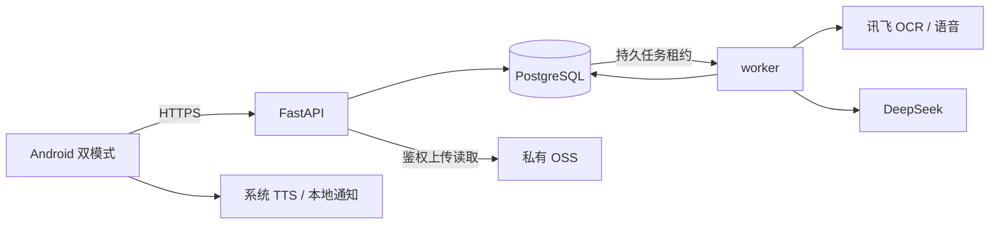

# Wellora（知安）架构与接口

2026-10-30（Asia/Shanghai）确认的开发约定，尚未实现。需求编号见[需求](需求.md)，页面与状态见[界面设计](界面设计.md)。Android 模板已存在；以下后端目录、数据表、路由和运行配置是计划，不是已部署服务。

## 1. 技术栈与职责

| 层 | 方案 | 职责／边界 |
| --- | --- | --- |
| Android | Kotlin、Jetpack Compose、ViewModel、Repository、协程／Flow、Navigation Compose | ViewModel 暴露状态；Repository 调 API 和本地保护存储；双模式共享业务状态 |
| 本地 | DataStore 保存非敏感偏好；Keystore 支持的加密文件保存草稿、会话凭证、缓存和提醒计划 | 不保存完整云端数据库；家庭资料不离线浏览；退出清凭证与敏感缓存 |
| API | Python 3.12、FastAPI、Pydantic 2、SQLAlchemy 2、Alembic、HTTPX | 单体模块处理会话、权限、版本、任务和供应商适配；不向客户端暴露数据库或密钥 |
| 数据库 | PostgreSQL 16 | 正式记录、授权、任务、用量、审计和删除台账；用迁移管理结构 |
| 工作进程 | 同代码镜像的独立 worker，PostgreSQL 持久队列 | OCR、AI、转写、PDF、备份恢复；初始并发 1，不引入 Redis、Celery、微服务 |
| 文件 | 已有阿里云 OSS，中国内地，具体地域待核实 | 私有原图、附件、导出物和备份；后端逐次鉴权流式读取 |
| 部署 | 香港 Ubuntu 24，4 核 4GB、40GB、15Mbps；Docker Compose | API、worker、PostgreSQL、HTTPS 反代；当前未部署 |

Android 先在现有 `app` 单模块内分 `ui/feature`、`data`、`model`、`core` 包；后端计划使用 `server/` 的 `api`、`services`、`models`、`providers`、`jobs`、`migrations`。本轮不创建代码目录和依赖清单。部署初始一个 API 和一个 worker；数据库只进内部网络。暂无域名与 HTTPS：仅用虚构数据本地联调，不能进行真实健康资料公网试用。

## 2. 数据流

报告流程为上传→任务→OCR 草稿→人工确认→已确认版本→解读／对比。OCR、转写和模型回答不能改变权限或绕过确认；报告修改会使旧解读、摘要和对比过期。任务执行前及落库前重验授权、对象未删除、输入版本未改变；晚到结果标 `stale`，失权或删除则取消和清理。

## 3. 核心对象

ID 使用不透明 UUID；时间存 UTC、接口 RFC3339；医学数值保留原文、十进制值和单位。可变对象含 `version`；权限以服务端 `profile_id` 归属为准。

| 对象 | 最小字段 | 约束 |
| --- | --- | --- |
| account / session | id、username、password_hash、status；token_hash、expires_at、revoked_at | 用户名唯一；Argon2id；令牌只存哈希；无邮箱验证和找回 |
| profile / health_record | owner_account_id、display_name、birth_date；kind、content、source_type、source_file_id、actor_id、confirmed_at、version | unknown、none、recorded 分开；医生结论和 AI 解释分开 |
| family_invitation / grant | inviter_id、invitee_id、profile_id、scopes、expires_at、status、version | view、edit、remind、export；edit 依赖 view，export 独立 |
| file_asset | profile_id、kind、object_key、sha256、mime、size、actor_id、status | 私有 OSS；跨账号不泄露去重信息 |
| report / report_revision | profile_id、file_ids、status、current_revision；patient、exam_date、institution、actor_id、confirmed_at、version | OCR 与人工修订分开；确认修订不可原位覆盖 |
| observation | report_revision_id、name_raw、canonical_code、value_raw、value_decimal、unit_raw、reference_raw、specimen、method、conditions、field_status | 低置信／缺失／确认分开；条件不足不假定可比 |
| analysis / comparison | profile_id、input_revision_ids、provider、model_id、prompt_version、sources、generated_at、status、result | queued、running、succeeded、failed、stale；不可比含 reason |
| consultation / message | profile_id、role、content、source_type、referenced_revision_ids、created_at、status | 区分用户、医生、AI；历史按权限和相关性使用 |
| medication_plan / dose_event | profile_id、drug_name、strength、dose、dose_unit、schedule、timezone、date_range、prescription_source、version；occurrence_id、state、actor_id | unconfirmed、taken、skipped；medical_check=unavailable |
| followup / reminder / notification | profile_id、doctor_conclusion、source、next_visit；schedule_version、due_at、recipient、delivery_state | 阅读不等于服药；本地触发、站内生成、送达、确认分开 |
| export / backup / restore | profile_id、variant、selected_ids、input_versions、file_id、status、expires_at；manifest_version、encryption_meta、conflicts | 恢复先验证、预览和确认，不静默覆盖 |
| job / usage / audit | kind、actor_id、profile_id、input_refs、idempotency_key、attempt、lease_until、status；provider、units、reserved_cost、actual_cost | 日志不存健康正文、密码、令牌；费用和状态可追溯 |
| deletion_tombstone | object_type、object_id、deleted_at、cleanup_status | 无健康正文；阻止读写及备份复活 |

## 4. API 公共约定

前缀 `/api/v1`。JSON UTF-8；集合 `{items,next_cursor}`；后台任务返回 202 和 `{task_id,status}`。除注册、登录、无健康信息的健康检查外均需 Bearer Token。

- 会话 7 天，可退出、改密、删除撤销；敏感操作密码复验获得 5 分钟、绑定当前会话的 `reauth_token`。不做自动找回，试用前明确告知忘记密码无法绕过认证读取健康资料。
- 用户名 3–32 位 ASCII 字母／数字／下划线，密码 12–128 字符；注册上限 20 个活跃试用账号。
- 权限由服务端逐次判断。无可见权返回 404，已可见但无操作权返回 403。
- 创建、消息、打卡、付费任务、恢复用 `Idempotency-Key`；24 小时同键同输入返回原结果，异输入 409 `IDEMPOTENCY_CONFLICT`。
- 更新和删除需 `version` 或 `If-Match`；不一致返回 409 `VERSION_CONFLICT`。上传检查签名、页数、大小；Range 下载也鉴权，不重定向公开 OSS URL。
- 图片只收 JPEG／PNG、每文件最多 10MiB；PDF 每文件最多 20MiB、20 页；单报告最多 20 页。音频采用 PCM WAV，最长 60 秒、10MiB，最终格式以讯飞产品联调核实后修订。损坏、加密或不支持文件 422；超限 413。未引用暂存文件 24 小时后清理。
- 列表默认 20、上限 100 条，使用不透明游标；检查日期用 `YYYY-MM-DD`，用药日程携带 IANA 时区。值字段以十进制字符串传输，保留原始比较符号与参考范围。

### 路由清单

| 方法／路径（省略 `/api/v1`） | 权限 | 请求／响应重点 | 需求 |
| --- | --- | --- | --- |
| GET `/health` | 公开 | 200 `{status:"ok"}` 或 503；不暴露数据库配置或健康数据 | R016 |
| POST `/auth/register`；POST `/auth/login`；POST `/auth/logout`；POST `/auth/reauth` | 公开／当前账号 | 注册 `{username,password}`；登录返回 token；复验返回短期 token；重名 409、错凭证 401 | R014 |
| GET/POST `/profiles`；GET/PATCH `/profiles/{id}`；GET/POST `/profiles/{id}/records`；PATCH `/records/{id}` | 本人／view／edit | 基础资料和来源记录；来源无权 422；版本冲突 409 | R003 |
| POST `/profiles/{id}/files`；GET `/files/{id}/content` | edit／view | multipart 上传返回 file_id、sha256、status；413／422；下载文件流 | R004、R015 |
| POST `/profiles/{id}/reports`；GET `/reports/{id}` | edit／view | 创建报告及原文件引用；患者不匹配 422、重复返回 duplicate_of | R004 |
| POST `/reports/{id}/ocr`；GET/PATCH `/reports/{id}/draft`；POST `/reports/{id}/confirm` | edit | 任务 202；草稿可改；确认返回 revision；关键项未确认 422 `REPORT_UNCONFIRMED` | R004 |
| POST `/reports/{id}/analyses`；GET `/analyses/{id}`；POST `/profiles/{id}/comparisons`；GET `/comparisons/{id}` | view | 仅已确认版本；202 任务；输入过期 409；比较结果含 points、comparable、reason、sources | R005、R011 |
| GET/POST `/profiles/{id}/consultations`；GET/POST `/consultations/{id}/messages` | view／操作者 | 文字消息及引用版本；失败保留原消息，不编回答；可继续历史 | R005、R013 |
| POST `/profiles/{id}/transcriptions` | 本人／edit | 音频任务返回转写，用户编辑后才正式写入；格式错误 422 | R004、R005 |
| POST `/profiles/{id}/department-guides`；GET `/department-guides/{id}` | view | 返回首选、备选、理由、补问、来源和 `risk_assessment_status`；不造预约 | R008 |
| GET `/capabilities`；GET `/emergency-config` | 登录／配置可匿名 | 医学风险和药品校验当前 `unavailable`；紧急配置不含健康数据 | R007 |
| GET/POST `/profiles/{id}/medications`；PATCH `/medications/{id}`；POST `/medications/{id}/confirm` | view／edit | 药品、剂量、频次、来源和版本；未匹配为 `medical_check=unavailable` | R006 |
| PUT `/medications/{id}/occurrences/{occurrence_id}`；POST `/medications/{id}/snoozes` | edit | `state=taken|skipped|unconfirmed`；重复幂等；旧计划版本冲突 | R006 |
| GET/POST `/profiles/{id}/followups`；PATCH `/followups/{id}` | view／edit | 复诊结论、附件、处方变更待确认、下一次提醒 | R012 |
| POST `/profiles/{id}/invitations`；GET `/family/invitations`；POST `/family/invitations/{id}/accept`、`/family/invitations/{id}/decline` | 本人／被邀请账号 | scopes 为 view、edit、remind、export；24 小时过期；双方确认 | R009 |
| GET `/profiles/{id}/grants`；GET/PATCH/DELETE `/profiles/{id}/grants/{grant_id}` | 仅本人改／撤销 | 撤销 204 后失效任务、通知和旧会话访问 | R009、R015 |
| GET `/notifications`；PATCH `/notifications/{id}` | 接收者 | `read_at` 不修改 dose_event；失权后不返回关联详情 | R006、R009 |
| GET `/knowledge`、`/knowledge/{id}` | 登录 | 仅已审核条目，含来源和更新时间；无内容为空列表 | R013 |
| POST `/profiles/{id}/exports`；GET `/exports/{id}` | 本人／export／复验 | 医生／通俗版本、范围、输入版本；202 后返回文件与来源 | R010 |
| POST `/profiles/{id}/backups`；POST `/profiles/{id}/restores/preview`；POST `/restores/{id}/confirm`；GET `/restores/{id}` | 仅本人／复验 | 加密备份、冲突预览、逐项确认；错误 422 `BACKUP_INVALID` | R010、R015 |
| GET `/tasks/{id}`；POST `/tasks/{id}/retry` | 原操作者仍有权 | 状态查询／重试；撤销 404，超预算 429，不重复业务结果 | R016 |
| POST `/tasks/{id}/secret` | 仅本人、复验 | `{passphrase,reauth_token}`；仅 awaiting_secret 任务接收，转交 worker 内存，不持久化；超时需重输 | R010、R015 |
| DELETE `/records/{id}`、`/reports/{id}`、`/account`；GET `/deletions/{id}` | 本人／复验 | 202 立即封锁；完成为 completed，失败 cleanup_failed | R015 |

示例：`POST /api/v1/reports/REPORT_ID/analyses` 携带 `Authorization` 和 `Idempotency-Key`，请求 `{"revision_id":"REVISION_ID"}`，响应 `{"task_id":"TASK_ID","status":"queued"}`。错误统一为 `{"error":{"code":"VERSION_CONFLICT","message":"资料已更新，请查看新版本后重试","request_id":"REQUEST_ID"}}`。常见 401/403/404、409、413/422、429、503 分别表示会话／权限、版本／幂等、输入、限流预算、供应商不可用；客户端保留输入、禁止展示占位医疗结果。

### 业务输入与输出示例

以下 ID、姓名和数值是接口槽位，不是用户事实；所有写入只接收允许字段，来源／操作者／时间由后端补充，不由客户端伪造。创建资源 201，普通读取／更新 200，撤销／退出 204，耗时处理 202。

| 接口组 | 最小请求 | 结果／失败约定 |
| --- | --- | --- |
| 注册／登录／改密 | `{username,password}`；`POST /auth/change-password` 需 `{current_password,new_password}` | 注册 `{account_id}`；登录 `{access_token,expires_at,account_id}`；改密撤销全部会话；错凭证统一 INVALID_CREDENTIALS，避免暴露账号存在性 |
| 档案与记录 | `{display_name,birth_date}`；记录 `{kind,content,source_type,source_file_id}`；修改加 `version` | 首版一账号一本人档案；返回 profile／record 及 version；家人以账号邀请取得权限，不匿名代建绕过授权 |
| 文件和报告 | multipart `{file,kind}`；报告 `{file_ids}`；OCR `{version}` | 文件 `{file_id,sha256,status}`；报告 `{report_id,status,version,duplicate_of}`；哈希相同只在同档案提示重复 |
| 校对与确认 | 草稿 `{version,fields}`；确认 `{version,confirmed_fields,missing_fields}` | 返回 revision_id、status、version；患者与关键值未确认拒绝分析；缺失单位可存草稿，不能猜填或默认可比 |
| 对比与解读 | `{revision_ids}`（对比至少两份）；解读 `{revision_id}` | GET 结果带 input_revision_ids、sources、generated_at、provider、model_id、prompt_version、status；每点原值、日期、单位、参考范围、可比性原因 |
| 咨询与科室 | 消息 `{text,revision_ids}`；科室 `{consultation_id,revision_ids,symptom_text}` | 消息先落库再排任务；科室 `{primary,alternatives,reasons,questions,sources,risk_assessment_status}`；状态 unavailable 不等于普通风险 |
| 用药计划与打卡 | `{drug_name,strength,dose,dose_unit,schedule,timezone,date_range,prescription_source}`；打卡 `{version,state}`；稍后 `{occurrence_id,remind_at}` | 确认前 draft，确认后 active；occurrence_id 由后端按计划版本生成；旧计划 occurrence 409，撤销打卡保留审计 |
| 复诊 | `{visit_date,department,doctor_conclusion,source_file_ids,next_visit}` | 返回 followup_id、version；处方变化不覆盖现计划，进入药品核对流程 |
| 家属邀请／授权 | `{invitee_username,scopes}`；接受 `{}`；改权 `{version,scopes,reauth_token}` | pending→active／declined／expired／revoked；仅邀请指定账号可接受；export 默认 false，edit 必须含 view；需查看权限才能下载与导出 |
| 导出／备份 | `{variant,selected_ids,input_versions,reauth_token}`；备份另需一次性 passphrase | 任务结果 `{file_id,expires_at,sources}`；variant 为 doctor／plain；导出操作必须有 export 权，输入资料过期 409 |
| 恢复 | 预览 multipart `{file,passphrase,reauth_token}`；确认 `{version,resolutions,reauth_token}` | 返回重复／冲突清单；resolutions 为保留当前或作为新修订导入；恢复只能本人原档案，已删对象拒绝复活 |
| 删除 | `{version,reauth_token}` | `{deletion_id,status,status_token}`；status_token 仅查询删除进度，不能读取健康资料，7 天过期；完成清理后 completed，不能将仅封锁写成删除完成 |

未列出的字段和专业阈值不得擅自添加为必填业务；实现 Pydantic 模型时以本表与第 3 节为基线细化 OpenAPI，并同步文档，不能反向改变需求。

## 5. 任务、外部服务与预算

任务 queued→running→succeeded／failed／stale／cancelled；worker 用 `FOR UPDATE SKIP LOCKED` 取任务，租约 60 秒、每 15 秒续期，超期回收，结果唯一约束防重复落库。预算预留与任务创建在同一事务，发送供应商请求前写调用记录。OCR、模型和语音均通过独立 provider 适配器，记录产品、模型和请求 ID，只发送必要资料。

租约回收若发现供应商调用已发送但结果不明，转入 failed／PROVIDER_RESULT_UNKNOWN 并核查，不重新发送付费请求；“可恢复任务”不等于外部调用可以无条件重放。恢复和导出前也要重验输入版本、授权与删除台账。

DeepSeek 用于通俗解释、咨询、科室参考；讯飞用于 OCR 和普通话转写；Android 系统 TTS 负责播报。具体模型、产品、格式、额度、价格和留存条款未核实，不能据协议兼容声称已联调。连接超时初值 10 秒，AI／OCR 读超时 120 秒，语音 90 秒；仅请求未发送或明确未受理时按 2／8 秒退避最多重试两次。已受理但结果未知先查供应商状态，无查询能力则 PROVIDER_RESULT_UNKNOWN，人工重试告知可能再次计费，不静默重发。

月度外部服务目标 100 元（Asia/Shanghai 月界，含模型、OCR、语音、OSS／流量，服务器另计）。接入前按最大输出／页数／时长预留费用，数据库锁定月余额；超预算返回 429 `BUDGET_EXCEEDED`，暂停新付费任务，不编造结果。初始预留 20 元给 OSS／流量，AI／OCR／语音池最多 80 元，待单价和账单核实再调整；单价未配置或实际费用未知时关闭新的付费调用，未核清的请求预留不释放。供应商账单可能延迟，不承诺本地估算是硬账单上限。初始每分钟账号 5 次、全局付费并发 1，实测后调整；登录连续失败 5 次冷却 15 分钟，并按 IP 限流。

## 6. 提醒、备份与删除

手机本地系统闹钟调度已确认计划，WorkManager 作校准；权限缺失或厂商限制需展示，不能承诺必达。计划变更、重启、时区变化重建调度并取消旧版本；正式服药状态必须联网确认，本地操作仅待发送。家属使用站内消息，前台及后台尽力同步，首版不接厂商推送，不承诺实时后台提醒；阅读不等于服药确认。锁屏默认仅显示“您有一条健康提醒”。

PDF 从同一份已确认事实快照派生医生版和通俗版，包含资料截止时间、来源和 AI 标识；导出物 24 小时后失效。用户备份采用版本清单和标准密码库实现的 AES-256-GCM、Argon2id 派生，随机盐与 nonce；口令不落库、不进任务载荷。需口令的任务进入 awaiting_secret，API 接收一次性口令并通过本机受限 Unix socket 交给单 worker（不走数据库队列），只留内存，worker 重启或未及时接收须重输；恢复需本人复验、预览、冲突选择。解密验证完整性、所属人、清单版本和文件哈希，限制解压大小并拒绝路径穿越，密钥／会话不放备份。实现时先验证该口令传递小流程，再纳入恢复，不引入额外常驻消息服务。

系统数据库和文件每日加密备份，最长保留 30 天；独立目的地和费用待确认，必须做恢复演练。删除同事务写 `deletion_tombstone`、撤销相关授权、取消任务并立即封锁；删账号还撤销全部会话。清理数据库、OSS 原图／历史版本、导出物、缓存和载荷后才 completed，失败为 cleanup_failed 并重试。删除台账独立加密保存，不含病情正文，至少覆盖全部相关备份保留期；系统恢复先应用最新台账，台账丢失或旧于备份则禁止开放服务，旧会话不恢复。用户备份也不能复活已删对象；第三方留存和删除限制须真实试用前核实。

## 7. 配置和接入门槛

计划环境项：`DATABASE_URL`、`PUBLIC_BASE_URL`、`OSS_ENDPOINT`、`OSS_BUCKET`、`OSS_ACCESS_KEY_ID`、`OSS_ACCESS_KEY_SECRET`、`DEEPSEEK_API_KEY`、`DEEPSEEK_MODEL`、`XFYUN_APP_ID`、`XFYUN_API_KEY`、`XFYUN_API_SECRET`、`XFYUN_OCR_PRODUCT`、`XFYUN_ASR_PRODUCT`、`MONTHLY_BUDGET_CNY`、`BACKUP_DESTINATION`。真实 `.env` 不入 Git；本轮不创建虚构可运行配置。

| 项目 | 当前事实 | 接入前门槛 |
| --- | --- | --- |
| OSS | 已有阿里云 OSS、中国内地，具体地域／Bucket 未知 | 私有策略、地域、生命周期、历史版本删除、跨地域数据流和告知 |
| DeepSeek／讯飞 | 服务商已选，具体产品、模型、账号额度、单价未知 | 官方文档核实接口、格式、留存、账单；脱敏样本联调 |
| TTS／提醒 | Android 系统中文播报，目标设备未定 | 验证语音包、录音格式、通知／闹钟权限和重启恢复 |
| 域名／HTTPS | 暂无 | 开通并验证 TLS 后才能公网真实资料试用；Caddy 仅为计划 |
| 医学／科普 | 暂无药品库、风险规则和专业审核 | 能力不可用；科普须来源、更新时间和发布审核 |
| 灾备／期限 | 外部服务月目标 100 元，期限未定 | 独立灾备位置、价格实核、恢复演练和阶段排期 |

### 第三方来源和自主实现边界

当前仅 Android 模板依赖已存在；计划依赖尚未安装、锁版本或核许可证。官方入口用于后续核实，不表示本轮已联网验证条款。引入时在本节补准确版本、许可证和使用范围，不直接复制完整开源项目。

| 来源 | 使用范围／许可证登记状态 |
| --- | --- |
| [Android Jetpack](https://developer.android.com/jetpack)、[Kotlin](https://kotlinlang.org/) | 客户端框架与模板；沿用现有版本目录，逐依赖核许可证后登记 |
| [FastAPI](https://fastapi.tiangolo.com/)、[SQLAlchemy](https://www.sqlalchemy.org/)、[Alembic](https://alembic.sqlalchemy.org/)、[Pydantic](https://docs.pydantic.dev/)、[HTTPX](https://www.python-httpx.org/) | 后端框架、数据库、验证、HTTP；锁定版本时核许可证 |
| [PostgreSQL](https://www.postgresql.org/)、[Docker](https://www.docker.com/)、[Caddy](https://caddyserver.com/) | 数据库与部署基础；镜像及运行版本许可证待核，不将基础软件算自主开发 |
| [DeepSeek](https://api-docs.deepseek.com/)、[讯飞开放平台](https://www.xfyun.cn/)、[阿里云 OSS](https://www.aliyun.com/product/oss) | 商业 API／存储，按实际产品条款与费用接入，不宣称自研模型／OCR／语音 |
| 用户提供的 Stitch 素材 | 原始字节归档；字体、图标、外链素材授权待核实，HTML 不作为 Android 实现直接复制 |

计划自主实现的是业务状态与权限、报告校对和版本、可比性处理、任务与费用控制、双模式交互、摘要与恢复流程；目前文档完成，代码实现尚未发生。
